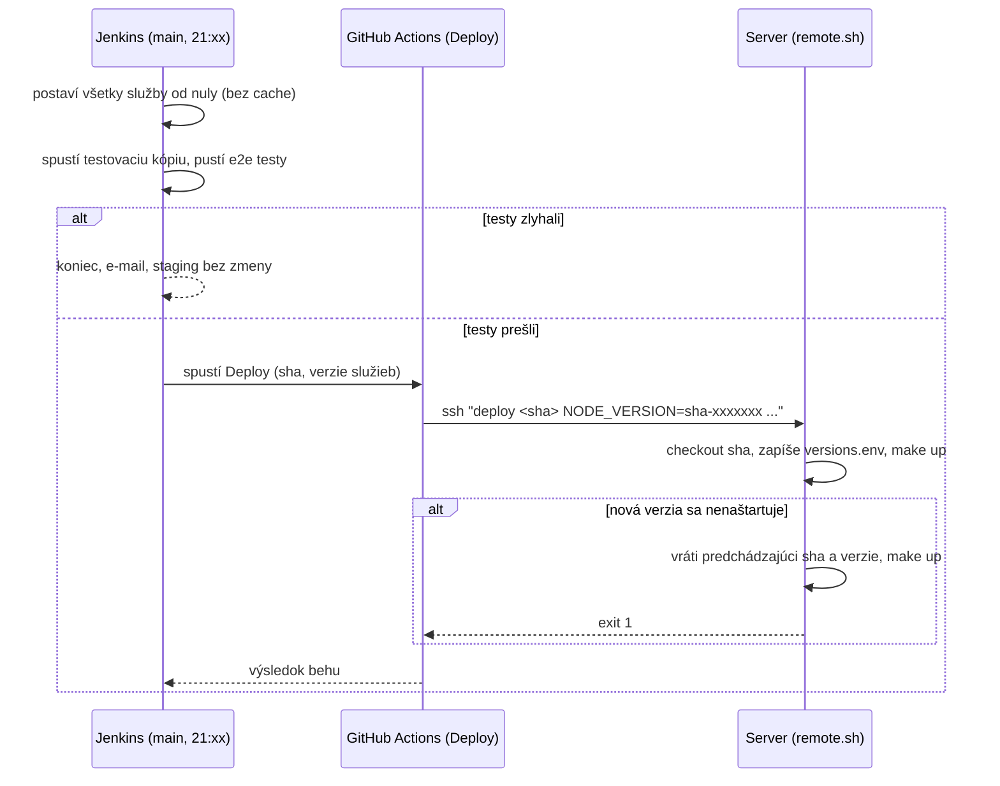

# CI/CD

Ako sa kód dostane z pull requestu na staging a kde hľadať, keď niečo zlyhá.

## Prehľad

| Kedy | Čo beží | Kde | Výsledok |
| --- | --- | --- | --- |
| PR alebo push v repozitári služby | `ci-ok`: lint, unit a integračné testy, audit závislostí, lint Dockerfile, obraz sa postaví a naštartuje | GitHub Actions | povinné pre merge |
| Push do `main` v repozitári služby | `docker.yml`: postaví obraz | GitHub Actions | `ghcr.io/pouw-zk/<repo>:main` a `:sha-<7>` |
| PR alebo push v `pouw-deploy` | `ci-ok`: kontrola konfigurácie, skripty na Linuxe, macOS a Windows, celá sieť z `main` služieb so smoke testami; pipeline v Jenkinse | GitHub Actions, Jenkins | povinné pre merge |
| Každý pondelok a pri každom PR | `security`: Trivy, actionlint | GitHub Actions | spoločný workflow organizácie |
| Každý večer (okolo 21:00) | pipeline v Jenkinse od nuly, potom nasadenie | Jenkins, GitHub Actions | staging aktualizovaný alebo bez zmeny |

## Pull requesty

Na `main` každého repozitára platí ruleset `protect-main`:

- zmeny iba cez pull request, merge typu squash;
- aspoň jedno schválenie a vyriešené všetky komentáre;
- povinné kontroly:
  - `ci-ok` v každom repozitári, ktorý ho má;
  - `continuous-integration/jenkins/pr-merge` v repozitároch, ktoré stavia
    Jenkins (zatiaľ iba `pouw-deploy`).

Pravidlá nastavuje skript `setup-pouw-deploy.sh` v koreni pracovného adresára
PoUW-ZK. Po pridaní `ci-ok` alebo `Jenkinsfile` do repozitára ho treba spustiť
znova (ako vlastník organizácie). Kontrola z Jenkinsu sa stane povinnou až
potom, čo Jenkins prvýkrát postaví `main` daného repozitára. Inak by pull
requesty čakali na build, ktorý nikdy nepríde.

Pull requesty z forkov Jenkins nestavia: repozitáre sú verejné a cudzí kód by
bežal na našom serveri. Vetvu treba pushnúť priamo do PoUW-ZK.

## Pipeline v Jenkinse

Definuje ju `Jenkinsfile` v `pouw-deploy`. Jenkins vytvorí job pre každý
repozitár PoUW-ZK, ktorý má `Jenkinsfile`, a v ňom podjob pre každú vetvu a
každý PR. PR sa stavia zlúčený s cieľovou vetvou, takže testuje presne to, čo
bude v `main` po merge.

| Stage | Príkaz | Čo robí |
| --- | --- | --- |
| Config check | `make check` | overí `compose.yml` pre všetky profily a konfiguráciu Promethea |
| Build services | `make images` | naklonuje `main` každej služby a postaví jej obraz; repozitáre bez `Dockerfile` preskočí; commity zapíše do popisu buildu |
| Network tests | `make test` | z týchto obrazov spustí testovaciu kópiu siete, pustí `e2e/smoke.sh` a potom `e2e/run.sh` každej služby |
| Deploy to staging | `scripts/staging-deploy.sh` | iba večerný build `main`, pozri nižšie |

Potom v bloku `post`:

- vždy: uloží výsledky testov (JUnit) a zoznam verzií `versions.txt`;
- pri zlyhaní alebo prerušení: uloží logy kontajnerov do `logs.txt`, pre `main` pošle e-mail;
- keď `main` po zlyhaní znova prejde: e-mail „FIXED“;
- na konci: zmaže testovaciu kópiu, nepoužívané obrazy a workspace.

### Izolácia buildov

Buildy bežia na agentovi `docker-agent`, nikdy na samotnom Jenkinse. Docker
príkazy z buildu idú do samostatného Dockeru (`jenkins-docker`,
Docker-in-Docker), nie do Dockeru servera. Build preto nevidí kontajnery
stagingu, ich dáta ani heslá v `/run/pouw-secrets`. Prečo, je v
[ADR-0002](../decisions/0002-izolovany-docker-pre-buildy.md).

Naraz môžu bežať dva buildy (2 executory). Každý má vlastný compose projekt
(`pouw-test-<executor>`) a tag obrazov (`ci-<executor>`). Testovacia kópia
nemá porty na hostiteľovi (`compose.test.yml`), takže sa buildy nebijú.

## E2E testy služieb

Unit testy patria do `tests/` v repozitári služby a bežia v GitHub Actions
(`ci-ok`). Testy, ktoré potrebujú bežiacu sieť (API, SOAP, spolupráca uzla a
indexera), patria do priečinka `e2e/` v repozitári služby. Spúšťa ich Jenkins
v stage Network tests, teda pri každom PR v `pouw-deploy` a večer pred
nasadením na staging.

Bežia na testovacej kópii siete, nie na stagingu. Kópia vznikne z toho istého
`compose.yml` a z tých istých verzií služieb, ktoré sa potom nasadia. Keď test
zlyhá, nasadenie sa zastaví, a testy nemenia dáta stagingu.

Každá služba má v `e2e/` rovnaké súbory:

| Súbor | Načo |
| --- | --- |
| `run.sh` | vstupný bod, ktorý volá `make test` |
| `test_*.py` | samotné testy (`pytest`) |
| `requirements.txt` | knižnice pre testy |
| `conftest.py` | bez bežiacej siete (napríklad `pytest` v `ci-ok`) priečinok preskočí |

Dohoda medzi `run.sh` a `pouw-deploy`:

- argument je názov compose projektu bežiacej siete;
- výsledky zapíše ako JUnit XML do `$JUNIT_DIR`, Jenkins ich ukáže v Tests;
- nenulový exit code znamená zlyhané testy, staging sa nenasadí.

`run.sh` pustí `pytest` v kontajneri pripojenom do siete testovacej kópie.
Služby sú dostupné podľa mena v `compose.yml` (`http://indexer:8000`), porty
na hostiteľovi nie sú. Bez súborov `test_*.py` sa nič nespustí. Ak služba
potrebuje iný nástroj ako `pytest`, stačí prepísať telo `run.sh` a dodržať
dohodu.

`make test` spustí testy služieb aj vtedy, keď niektoré predtým zlyhali, a
zlyhá na konci. Testy sa berú z `main` služieb, ktoré naklonuje `make images`.
Keď e2e test v PR služby zlyhá, ukáže sa to preto až vo večernom builde.
Lokálne sa dajú pustiť služby aj testy z vlastných pracovných kópií vedľa
`pouw-deploy` (`make dev-test` = `make images test SRC=..`):

```bash
make dev-test
make test-down
```

## Večerný build a nasadenie na staging



1. Časovač v `Jenkinsfile` platí iba pre vetvu `main`. Jenkins ho zaregistruje
   po prvom builde `main`.
2. Večerný build stavia s `NO_CACHE=1`, takže obrazy vzniknú od nuly a
   zachytia nové základné obrazy aj závislosti.
3. Ak testy prejdú, `scripts/staging-deploy.sh` cez GitHub App spustí workflow
   Deploy a počká na výsledok. Ak nasadenie zlyhá, zlyhá aj build v Jenkinse.
4. Workflow Deploy sa pripojí cez SSH kľúčom, ktorý smie spustiť iba
   `scripts/remote.sh`. Ten prijme iba commit, ktorý je v `origin/main`,
   nasadí ho a pri zlyhaní `make up` sa automaticky vráti na predchádzajúcu
   verziu.

Na staging sa teda nikdy nedostane nič, čo neprešlo testami, a pokazené
nasadenie vráti predchádzajúci stav. Podrobnosti v
[ADR-0004](../decisions/0004-vecerny-deploy-na-staging.md).

## Kde nájdem výsledky

| Otázka | Kde |
| --- | --- |
| Ktoré testy prešli a ktoré nie, a odkedy? | Jenkins → PoUW-ZK → pouw-deploy → main → build → **Tests** |
| Ktoré commity služieb sa testovali? | popis buildu alebo artefakt `versions.txt` |
| Prečo testovacia sieť zlyhala? | artefakt `logs.txt` zlyhaného buildu |
| Čo je teraz nasadené na stagingu? | GitHub → Actions → Deploy → Run workflow → akcia `status` |
| História nasadení a rollbackov | `deploy-history.log` v `~/pouw/pouw-deploy` na serveri |
| Unit testy jednej služby | GitHub Actions daného repozitára, job `ci-ok` |
| E2E testy služieb | Jenkins → build → **Tests**, sada podľa mena repozitára |

## E-maily

Posielajú sa iba za buildy `main` (výsledky PR sú vidno na GitHube):

- **FAILED**: build zlyhal alebo bol prerušený (napríklad timeout). Obsahuje
  odkaz, otestované commity služieb, zlyhané testy a koniec logu. Staging v
  tomto prípade zostáva bez zmeny.
- **FIXED**: `main` po zlyhaní znova prešiel.

Príjemca je `NOTIFY_EMAIL` v `Jenkinsfile`. Na odosielanie treba SMTP účet,
pozri časť SMTP v [inštalácii servera](instalacia.md). Bez neho buildy
fungujú, iba sa neposielajú e-maily.

## Verzie služieb

Na stagingu bežia presne tie verzie služieb, ktoré prešli večernými testami:

- `scripts/build-images.sh` zapíše postavené commity do `build/versions.env`
  (`NODE_VERSION=sha-abc1234`, …).
- Workflow Deploy ich odovzdá `remote.sh`, ktorý ich uloží do `versions.env`
  na serveri. `Makefile` tento súbor načíta, takže verzie platia aj po
  `make restart`.
- Compose potom stiahne `ghcr.io/pouw-zk/<repo>:sha-<7>`, teda obraz, ktorý
  `docker.yml` postavil z toho istého commitu.

Ručné nasadenie bez verzií použije obrazy `:main`.
