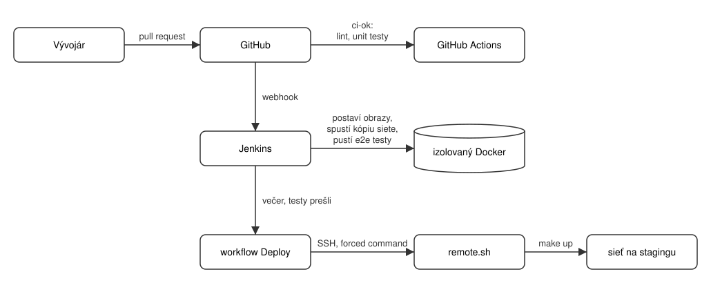

# Server a nasadenie

Ako beží sieť PoUW-ZK mimo notebookov: staging server, Jenkins, nočné testy
celej siete a nasadenie. Kód je v repozitári
[pouw-deploy](https://github.com/PoUW-ZK/pouw-deploy), dôvody hlavných
rozhodnutí v [ADR-0001 až ADR-0005](../decisions/index.md).

## Prostredia

| Prostredie | Kde | Čo tam beží |
| --- | --- | --- |
| Lokálne | notebook člena tímu | sieť, voliteľne Jenkins s lokálnym prihlásením |
| Staging | server FIIT `pouw-dev` (147.175.151.18) | sieť, Jenkins, HTTPS proxy |

| Služba | Adresa na stagingu | Prihlásenie |
| --- | --- | --- |
| Jenkins | <https://jenkins.147-175-151-18.sslip.io> | GitHub účet, člen organizácie PoUW-ZK |
| Grafana | <https://grafana.147-175-151-18.sslip.io> | `admin`, heslo: `pass show pouw/grafana/admin` na serveri; dashboardy v priečinku PoUW |

## Ako to do seba zapadá



- Každý repozitár služby má vlastnú kontrolu `ci-ok` v GitHub Actions (lint,
  unit testy, audit závislostí). Pull request potrebuje `ci-ok` a jedno
  schválenie.
- Jenkins postaví všetky služby z `main`, spustí ich spolu v izolovanej
  testovacej kópii siete a pustí testy celej siete z `e2e/`.
- Každý večer beží to isté od nuly. Ak testy prejdú, otestované verzie
  nahradia staging. Ak niečo zlyhá, staging zostane, ako bol, a príde e-mail.

## Stránky v tejto sekcii

| Stránka | Kedy ju čítať |
| --- | --- |
| [CI/CD](ci-cd.md) | čo beží pri pull requeste, každý večer a ako sa aktualizuje staging |
| [Inštalácia servera](instalacia.md) | inštalácia servera od nuly a nastavenie GitHubu |
| [Prevádzka](prevadzka.md) | nasadenie, rollback, heslá, nová služba alebo test, riešenie problémov |

## Lokálne spustenie

Potrebuješ Docker s Compose 2.24+, `make`, `openssl` a `ssh-keygen`.
Repozitáre služieb majú byť naklonované vedľa `pouw-deploy` (napríklad cez
`.github/scripts/sync-repos.sh`):

```bash
cd pouw-deploy
cp .env.example .env
make dev         # postaví všetky služby z ../pouw-* (aj s necommitnutými zmenami) a spustí celú sieť
make dev-test    # tie isté obrazy, testy siete v samostatnej kópii, výsledky v reports/
make down        # zastaví všetko, dáta zostanú
```

Návod na prvé použitie na Linuxe, macOS a Windows (WSL 2), bežnú prácu a
písanie testov je v [README pouw-deploy](https://github.com/PoUW-ZK/pouw-deploy#readme).
Bez vlastných zmien v službách stačí `make up`: služby sa stiahnu z GHCR
(`:main`). Hasura (s profilom `network`) beží na <http://localhost:8081>, Prometheus na
<http://localhost:9090>, Grafana na <http://localhost:3000> (heslo v
`.secrets/grafana_admin_password`). Všetky príkazy vypíše `make help`.

## Základné pravidlá

- Heslá nikdy nepatria do gitu ani do `.env`. Na serveri sú v `pass`, lokálne
  v `.secrets/`. Ich zoznam je v `secrets.list`.
- Jenkins sa nastavuje iba v `jenkins/casc/`. Zmeny v UI sa pri reštarte stratia.
- Zvonka je na serveri dostupná iba proxy na portoch 80 a 443. Ostatné porty sú
  iba na `127.0.0.1`.
